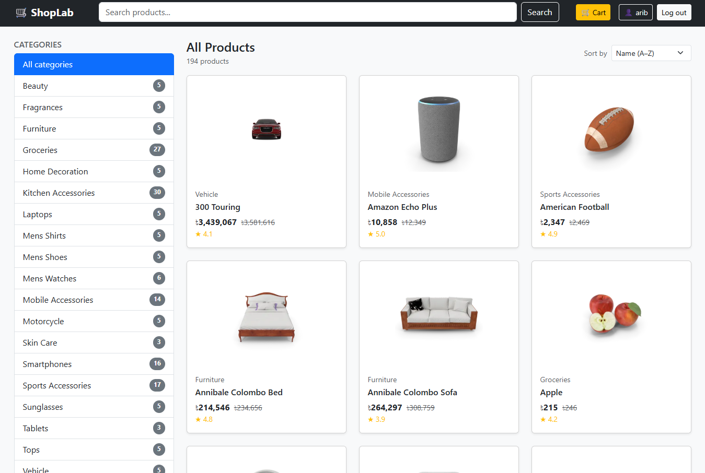
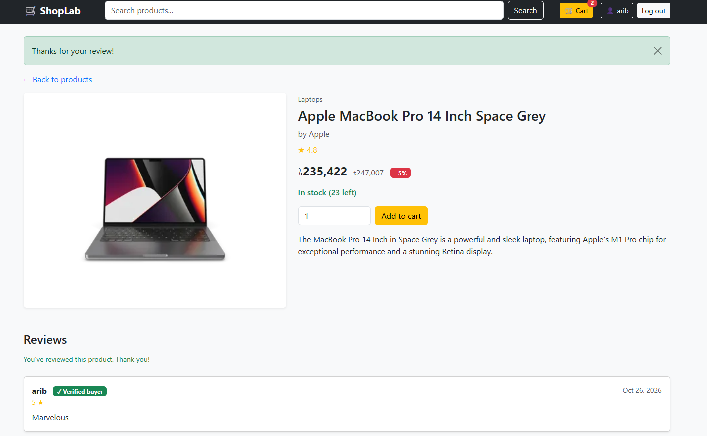
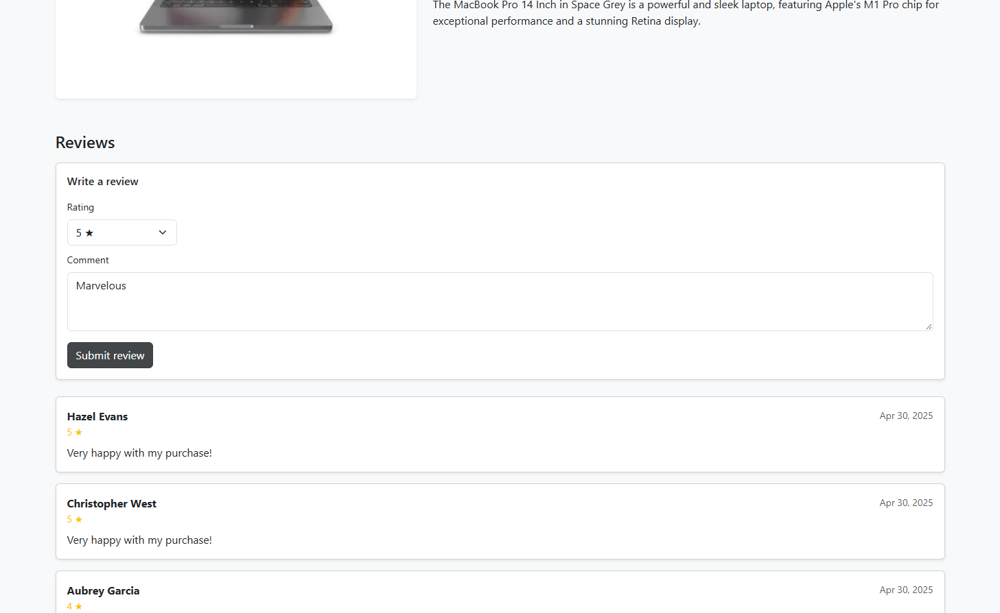
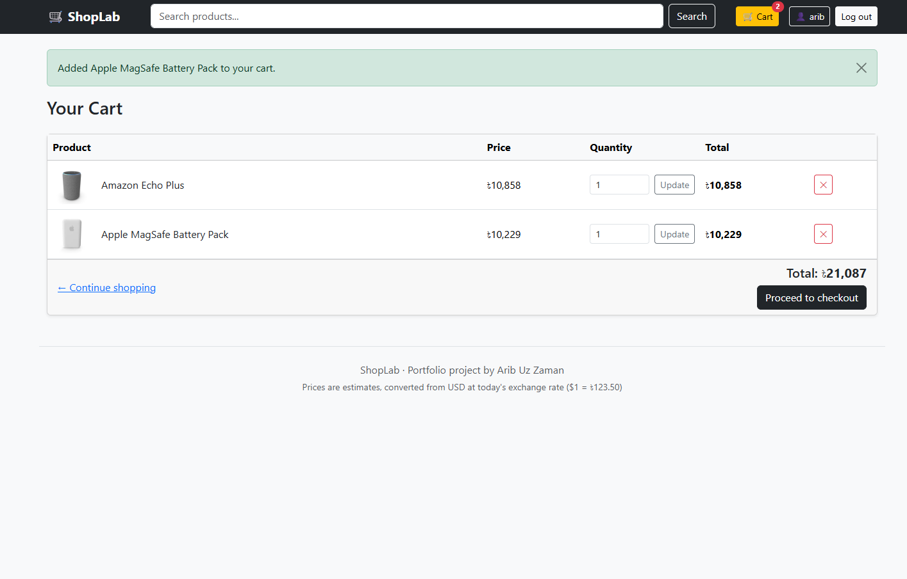
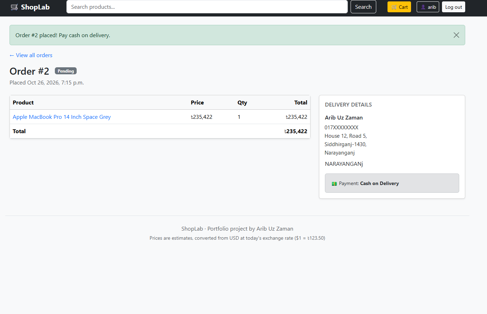
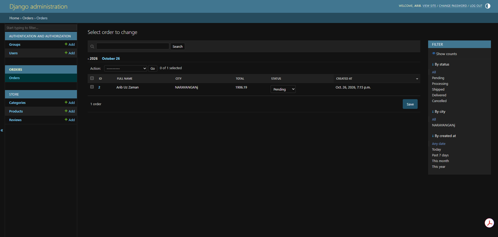

# 🛒 ShopLab: Full-Stack Django E-commerce Store

A complete online store built with Django: product catalog, search, user accounts,
cart, Cash-on-Delivery checkout, order tracking, and verified-buyer reviews.
It's designed as the foundation for AI features (recommendations, review sentiment
analysis and a shopping assistant) coming in my next projects.



## ✨ Features

**Shopping**
- Product catalog (194 products, 24 categories) with search, category filter, sorting and pagination
- Prices shown in taka (৳), converted from USD at a live exchange rate
- Session-based cart that works for guests and survives login
- Checkout with Bangladeshi phone validation and Cash on Delivery
- Order history and order detail pages with status tracking

**Accounts & Reviews**
- Sign up, log in, log out (Django authentication), with duplicate-email protection
- Only verified buyers can review, one review per product, with live average ratings

**Admin**
- Manage products (with image previews and stock filters), categories, reviews and orders
- Orders show their items inline, and status can be changed straight from the list

## 🔒 Engineering Decisions
| Problem | Solution |
|---|---|
| Half-saved orders | Order creation runs in one atomic database transaction |
| Overselling the last item | Stock checked inside the transaction, rows locked with `select_for_update` (enforced on PostgreSQL), stock reduced with `F()` expressions |
| Old orders changing when prices change | Product title and price are snapshotted into each order item |
| Viewing other users' orders (IDOR) | Orders are always filtered by the logged-in user, so others get a 404 |
| Duplicate reviews | Database-level unique constraint plus friendly validation (double-clicks handled too) |
| Invalid prices, discounts or ratings | Validators in forms, plus `CheckConstraint`s in the database |
| Slow pages from repeated queries | `select_related` / `prefetch_related` / `annotate` to avoid the N+1 query problem |
| Unsafe sort parameters | Sort options allowlisted, never passed raw to the database |
| Exchange-rate API outages | Rate cached for 6 hours; if the API is down, prices fall back to USD instead of breaking the page |

## 🛠 Tech Stack
Python · Django 5.2 · SQLite · Bootstrap 5 · Django test framework

## 🧪 Tests
53 automated tests covering products, search, filtering, sorting, pagination, currency conversion,
cart, checkout, stock rollback, permissions, accounts and reviews.
```bash
python manage.py test
```

## 🚀 Run Locally
```bash
git clone https://github.com/Aribdebugs/shoplab.git
cd shoplab
python -m venv .venv
.venv\Scripts\activate            # Mac/Linux: source .venv/bin/activate
pip install -r requirements.txt
python manage.py migrate
python manage.py import_products  # loads 194 demo products from DummyJSON
python manage.py createsuperuser
python manage.py runserver
```
Open http://127.0.0.1:8000. The admin is at /admin.

## 📁 Project Structure
```
shoplab/
├── config/        # settings and root URLs
├── store/         # products, categories, reviews, cart, search, currency conversion
├── accounts/      # sign up, login, account page
├── orders/        # checkout, orders, order service
├── templates/     # shared base layout
└── docs/          # screenshots
```

## 📸 Screenshots
| Product page with a verified-buyer review | Writing a review (buyers only) |
|---|---|
|  |  |

| Cart | Order confirmation |
|---|---|
|  |  |

**Admin: orders with status filters and inline status editing**



## 📝 Notes
- Product data comes from [DummyJSON](https://dummyjson.com) (fake demo data).
- Prices are converted from USD to BDT at a live exchange rate from [open.er-api.com](https://open.er-api.com), so they are estimates.
- Payment is simulated (Cash on Delivery); no real payments are processed.

## 🔮 Coming Next
- AI product recommendations ("You may also like")
- Review sentiment analysis (Bangla + English)
- AI shopping assistant chatbot (RAG)
- Online payment sandbox (bKash / SSLCommerz)
- Deployment with PostgreSQL
